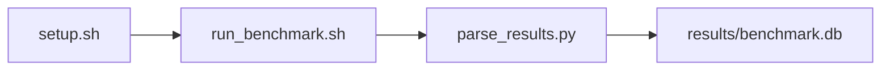

# Silent Data Corruption (SDC) Benchmark

[](LICENSE)
[](.github/workflows/ci.yml)

Target: Ubuntu 26.04 · AMD · see Hardware Requirements. This is a host benchmark, not a laptop `pip install` project.

## Quick Start

```bash
git clone https://github.com/garys-gpu-benchmarks/304-gpu-bench-amd-sdc-ecc-integrity-ubu2604.git
cd 304-gpu-bench-amd-sdc-ecc-integrity-ubu2604
sudo bash setup.sh --assume-yes
bash run_benchmark.sh --profile smoke --validate
```
Results are written to `results/benchmark.db` and `results/summary.json`.

This workload is executed on the validation host after the repository is copied there. `setup.sh` and `run_benchmark.sh` do not open an outbound SSH session.

Prerequisites: Ubuntu 26.04; AMD; Python 3.14.4; root or sudo for `setup.sh`. Framework: Bash, SQLite, Python, PyYAML, ROCm Runtime, PyTorch-ROCm. This is a host benchmark, not a laptop `pip install` project.



## 1. Overview

Runs a PyTorch GPU (or CPU) int32 buffer check that writes 1 to even-index elements and verifies them, then reports a 0-100 pass rate in even_word_store_pass_rate. duration: wall-clock cap (values >=10000 treated as milliseconds). num_iterations: verify loops. memory_size: allocation size in GB (clamped to at least 0.125). Sweep dimensions: device_id, memory_size, pattern_type, ecc_check, num_iterations, output_format, duration, count.

## 2. What It Validates

- Validates that the even-index int32 write/verify loop completes and reports the allocated GPU buffer size plus a 0-100 pass rate. RAS counter deltas come from rocm-smi. RVS is not used
- #1: RAS uncorrectable counter delta (uncorrected_ecc_errors_count); is present and physically sensible.
- #2: RAS correctable counter delta (corrected_ecc_errors_count); is present and physically sensible.
- #3: Wall-clock time, s (test_wall_clock_completion_time_s); is present and physically sensible.
- #4: Allocated verification buffer, GB (hbm3_coverage_gb); is present and physically sensible.
- #5: Even-index int32 verification pass rate (even_word_store_pass_rate) is present and physically sensible.

## 3. Metrics Captured

- **#1: RAS uncorrectable counter delta** — stored as `uncorrected_ecc_errors_count`.
- **#2: RAS correctable counter delta** — stored as `corrected_ecc_errors_count`.
- **#3: Wall-clock time, s** — stored as `test_wall_clock_completion_time_s`.
- **#4: Allocated verification buffer, GB** — stored as `hbm3_coverage_gb`.
- **#5: Even-index int32 verification pass rate** — stored as `even_word_store_pass_rate`.

## 4. Hardware Requirements

### Supported environment

- OS: Ubuntu 26.04
- GPU vendor: AMD
- Framework family: Bash, SQLite, Python, PyYAML, ROCm Runtime, PyTorch-ROCm
- Python: Python 3.14.4

### Reference validation environment

The tables below describe the machine used to generate the reference results. They are not a requirement that every user buy that exact cloud instance.

### System

Ubuntu 26.04 / AMD / Bash, SQLite, Python, PyYAML, ROCm Runtime, PyTorch-ROCm

### GPU

Ubuntu 26.04 / AMD / Bash, SQLite, Python, PyYAML, ROCm Runtime, PyTorch-ROCm

## 5. Software Requirements

| Component | Version |
|---|---|
| OS | Ubuntu 26.04 |
| Kernel | kernel 7.0.0 |
| Python | Python 3.14.4 |
| ROCm | ROCm 7.14 |
| rocBLAS | N/A - rocBLAS not used |

Runs a PyTorch GPU (or CPU) int32 buffer check that writes 1 to even-index elements and verifies them, then reports a 0-100 pass rate in even_word_store_pass_rate. duration: wall-clock cap (values >=10000 treated as milliseconds). num_iterations: verify loops.

## 6. Installation

```bash
Run an in-process PyTorch even-index int32 write/verify on cuda:0 when available, otherwise CPU. Does not run rvs or a HIP ecc_walk binary
```

## 7. Running the Benchmark

```bash
Run an in-process PyTorch even-index int32 write/verify on cuda:0 when available, otherwise CPU. Does not run rvs or a HIP ecc_walk binary
```

**Validating results separately:**

```bash
export BENCHMARK_PYTHON=/usr/bin/python3.13  # optional
python3 -m venv .venv
source ".venv/bin/activate"
".venv/bin/python" scripts/validate_results.py
```

## 8. Output

### `results/benchmark.db` (SQLite)

CSV aggregate of the verify run. A single row is duplicated to two samples

sample_index,status,uncorrected_ecc_errors_count,corrected_ecc_errors_count,hbm3_coverage_gb,even_word_store_pass_rate,test_wall_clock_completion_time_s,error_message
0,ok,0,0,0.125,100,1.2,

```bash
Run an in-process PyTorch even-index int32 write/verify on cuda:0 when available, otherwise CPU. Does not run rvs or a HIP ecc_walk binary
```

### `results/summary.json`

Consolidated metrics from the most recent run — suitable for CI artifact upload or dashboard ingestion.

### `results/raw/<timestamp>.txt`

CSV aggregate of the verify run. A single row is duplicated to two samples

sample_index,status,uncorrected_ecc_errors_count,corrected_ecc_errors_count,hbm3_coverage_gb,even_word_store_pass_rate,test_wall_clock_completion_time_s,error_message
0,ok,0,0,0.125,100,1.2,

## 9. Baselines / Thresholds

Expected ranges and gates live in `config/benchmark_config.yaml` under `baselines:` or `thresholds:`. To update them, edit that file — never edit validation code directly.

## 10. Troubleshooting

**`setup.sh` missing collector**
Create cannot finish without `scripts/collect_workload.py`.

**`self_check` overlay rewritten**
Do not overwrite files listed in `results/overlay_lock.json`.

**Remote SSH drop during setup**
Reconnect and resume `bash setup.sh --assume-yes`. Do not wipe `.venv` or `.cache`.

## 11. NVIDIA H100 Coding Differences

Primary target is AMD ROCm. NVIDIA notes in this section are reference only and are not the execution path.

## Repository layout

```text
.
├── setup.sh
├── run_benchmark.sh
├── benchmark_specification.json
├── config/
├── scripts/
├── src/
├── tests/
├── docs/
├── results/
└── LICENSE
```
